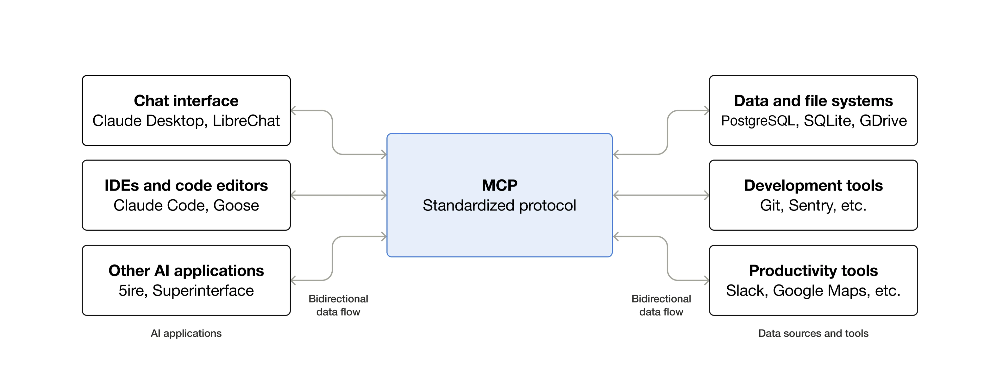

### What Is MCP?

Model Context Protocol (MCP) is an open-source, standardized protocol used to connect AI Agents to third-party systems. 


_Source: modelcontextprotocol.io_

Prior to MCP, every AI Agent needed custom code written to connect it to every third-party system. Referred to as the "NxM" problem by Anthropic, the obvious issue that quickly arose was not just the amount of custom code written for integrations, but the number of integrations needed. "NxM" referred to the number of AI clients (M) multiplied by the number of third-party tools (N), which reflected the quickly growing number of integrations. 

For example, if you're running 3 clients and want to connect to 10 applications, prior to MCP that would mean 30 integrations (3x10=30). With MCP, that becomes "M+N" (3+10=13) as the third-party application developer needs only one MCP Server to work with all AI clients.

MCP was originally developed by Anthropic in November 2024, adopted by other major AI providers, and subsequently donated to the Agentic AI Foundation (under the Linux Foundation). 

There are three roles in MCP:

1. Host: the AI application (e.g. Claude Code).
2. Client: the part of the Host that talks to one MCP Server (multiple of these can exist under the same Host).
3. Server: the third-party application's exposure of their application's capabilities to AI Agents (similar to an API, but for AI Agents).

### How an MCP Server Works

There are two types of MCP Servers, and while they both work similarly, there are some differences. These server types are:

1. Local
2. Remote

#### Local

A Local MCP Server is launched by the AI app itself (in my case, Claude Code). For Claude Code, the command to do so is located in the .mcp.json file and prompts the user whether it should be used at the start of the Claude Code session. 

Once running, only I (and by extension Claude Code) can reach it and it only has access to the resources that my user account has access to. 

The subsequent exchange is:

1. The local Claude Code session sends a "server/discover" request stating its name, version, and capabilities. 
2. The MCP Server responds with the MCP protocol version it speaks, the kinds of features it supports (Tools, Resources, Prompts), and a general description of the MCP Server.
3. Claude Code sends "subscriptions/listen" in order to request that it is notified if the Tool, Prompt, or Resource listing changes. The server acknowledges.
4. Claude Code sends three more requests -- "prompts/list", "resources/list", and "tools/list" in an effort to request what is available from the server. The server responds with any items available of the corresponding categories.
5. Nothing more is exchanged until the model decides it needs one of the server's Tools.

The exchange above follows the 2026-07-28 version of the MCP specification. Earlier versions (2025-11-25 and before) open with an "initialize" handshake that sets up a session instead, so if you're following an older tutorial, that's why the first messages may look different.

#### Remote
A Remote MCP Server runs on a third party's infrastructure such as GitHub, Cloudflare, and others. Instead of a command, the .mcp.json file holds the server's URL. The JSON traffic is sent over HTTP POST messages.

Beyond that, there isn't much different about the core functionality of a Remote MCP Server versus a Local one. The learning curve is the authentication/authorization piece which is largely unnecessary in Local MCP Servers.

The exchange is the following:

1. Claude Code sends its first request to the server's URL. Since it doesn't have a token yet, the server replies "401 Unauthorized" and points Claude Code to where it can sign in.
2. Claude Code opens a browser window, where I sign in with the provider and approve access (OAuth 2.1). Claude Code receives an access token and attaches it to every request from then on.
3. The rest mirrors the local exchange: "server/discover", "subscriptions/listen", and the three list requests. The JSON messages are the same, but each one is sent as its own HTTPS POST instead of over stdin/stdout.
4. The server answers each request with either a single JSON reply or a short stream of messages. The "subscriptions/listen" stream stays open so the server can announce changes.
5. As with local, nothing more happens until the model needs a Tool. Each Tool call is another POST with the token attached, and the server checks the token every time.

==============

_The messages below come from a trace of a Local MCP Server I created. The MCP Server is designed to facilitate communication between Claude Code and a Task Tracker application backed by a SQLite database._ 

_Claude Code attaches the same `_meta` block to every request, so it's shown in full in (1) and removed from later messages for readability._

==============

Here's what the local exchange looks like:

(1) Claude Code → MCP Server:

```json
{
  "jsonrpc": "2.0",
  "id": "server-discover-probe-1",
  "method": "server/discover",
  "params": {
    "_meta": {
      "io.modelcontextprotocol/protocolVersion": "2026-07-28",
      "io.modelcontextprotocol/clientInfo": {
        "name": "claude-code",
        "title": "Claude Code",
        "version": "2.1.296",
        "description": "Anthropic's agentic coding tool",
        "websiteUrl": "https://claude.com/claude-code"
      },
      "io.modelcontextprotocol/clientCapabilities": {
        "roots": {
          "listChanged": true
        },
        "elicitation": {
          "form": {},
          "url": {}
        }
      }
    }
  }
}
```

(2) MCP Server → Claude Code:

```json
{
  "jsonrpc": "2.0",
  "id": "server-discover-probe-1",
  "result": {
    "cacheScope": "private",
    "capabilities": {
      "prompts": {
        "listChanged": true
      },
      "resources": {
        "listChanged": true,
        "subscribe": true
      },
      "tools": {
        "listChanged": true
      }
    },
    "instructions": "A personal task tracker. Use these tools to add, list, search, complete, and delete tasks stored in a local SQLite database.",
    "resultType": "complete",
    "supportedVersions": [
      "2026-07-28"
    ],
    "ttlMs": 0,
    "_meta": {
      "io.modelcontextprotocol/serverInfo": {
        "name": "task-tracker",
        "version": ""
      }
    }
  }
}
```

(3) Claude Code → MCP Server:

```json
{
  "jsonrpc": "2.0",
  "id": "listen:0",
  "method": "subscriptions/listen",
  "params": {
    "notifications": {
      "toolsListChanged": true,
      "promptsListChanged": true,
      "resourcesListChanged": true
    }
  }
}
```

MCP Server → Claude Code:

```json
{
  "jsonrpc": "2.0",
  "method": "notifications/subscriptions/acknowledged",
  "params": {
    "_meta": {
      "io.modelcontextprotocol/subscriptionId": "listen:0"
    },
    "notifications": {
      "toolsListChanged": true,
      "promptsListChanged": true,
      "resourcesListChanged": true
    }
  }
}
```

(4) Claude Code → MCP Server (prompts):

```json
{
  "method": "prompts/list",
  "jsonrpc": "2.0",
  "id": 1,
  "params": {}
}
```

MCP Server → Claude Code (no prompts):

```json
{
  "jsonrpc": "2.0",
  "id": 1,
  "result": {
    "cacheScope": "private",
    "prompts": [],
    "resultType": "complete",
    "ttlMs": 0
  }
}
```

Claude Code → MCP Server (resources):

```json
{
  "method": "resources/list",
  "jsonrpc": "2.0",
  "id": 2,
  "params": {}
}
```

MCP Server → Claude Code (no resources):

```json
{
  "jsonrpc": "2.0",
  "id": 2,
  "result": {
    "cacheScope": "private",
    "resources": [],
    "resultType": "complete",
    "ttlMs": 0
  }
}
```

Claude Code → MCP Server (tools):

```json
{
  "method": "tools/list",
  "jsonrpc": "2.0",
  "id": 3,
  "params": {}
}
```

MCP Server → Claude Code (first of five Tools shown):

```json
{
  "jsonrpc": "2.0",
  "id": 3,
  "result": {
    "cacheScope": "private",
    "resultType": "complete",
    "tools": [
      {
        "description": "Add a new open task.\n\n    Args:\n        title: Short name of the task.\n        description: Optional longer details.\n        due_date: Optional due date in YYYY-MM-DD format.\n\n    Returns the newly created task.\n    ",
        "inputSchema": {
          "type": "object",
          "properties": {
            "title": {
              "title": "Title",
              "type": "string"
            },
            "description": {
              "default": "",
              "title": "Description",
              "type": "string"
            },
            "due_date": {
              "anyOf": [
                {
                  "type": "string"
                },
                {
                  "type": "null"
                }
              ],
              "default": null,
              "title": "Due Date"
            }
          },
          "required": [
            "title"
          ],
          "title": "add_taskArguments"
        },
        "name": "add_task"
      }
    ],
    "ttlMs": 0
  }
}
```

(5) I then asked Claude to add a task. Claude Code → MCP Server:

```json
{
  "method": "tools/call",
  "params": {
    "name": "add_task",
    "arguments": {
      "title": "Renew car registration",
      "due_date": "2026-10-20"
    }
  },
  "jsonrpc": "2.0",
  "id": 4
}
```

MCP Server → Claude Code:

```json
{
  "jsonrpc": "2.0",
  "id": 4,
  "result": {
    "content": [
      {
        "text": "{\n  \"id\": 1,\n  \"title\": \"Renew car registration\",\n  \"description\": \"\",\n  \"status\": \"open\",\n  \"created_at\": \"2026-10-10T14:11:55\",\n  \"due_date\": \"2026-10-20\"\n}",
        "type": "text"
      }
    ],
    "isError": false,
    "resultType": "complete"
  }
}
```


### MCP vs. REST APIs

While learning about MCP Servers, I couldn't help but draw comparisons between them and APIs.

If at the end of the day all we're doing is interacting with the same data, what is the point of using a separate MCP Server if the rails already exist for this and an LLM could communicate via the API endpoint?

Some points I found to be worth considering (and obviously the market agrees they are worthwhile):

- First and foremost, before MCP Servers, each integration between an AI Host and an application required custom code. This included connecting to a given API. MCP allows for a standardized protocol. 
- An LLM can send a `tools/list` message and receive a description intended for a machine (instead of a human developer). An API has no similar discovery mechanism outside of the REST API documentation.
- Even in cases where an API doesn't exist, a Local MCP Server can be created and used to interact with a given application. 
- Some MCP features have no REST equivalent (e.g., list-change notifications from the MCP Server, Elicitation from the MCP Server, and others.)

There are still cases where having an Agent just use the CLI or even interact with an application's API makes sense. At scale though, having a standardized protocol with some additional features intended for machine consumption is more beneficial.

It's also worth noting that MCP and APIs aren't an either/or. Many MCP Servers sit in front of an application's existing API -- each Tool call gets translated into one or more API calls behind the scenes. MCP is the layer that makes the API approachable for AI Agents, not a replacement for it.

### Security Considerations

There are several security considerations with MCP Servers, but I will group them into two broad categories:

1. Access
2. Injection

**Access** - With Access related security considerations, it is up to you to consider what this MCP Server provides access to, what your user account can access, and what the MCP Server can do. 

It sounds simple on the surface, but there are various ways mistakes can easily happen.

We've seen cases where organizations have provided Microsoft 365 integration with Claude or Copilot, and suddenly employees can see data they never knew existed and weren't intended to see. The user could always see those documents relative to their permissions, but when providing access to AI, you have to assume content will be visible unless it's specifically segmented off with the correct permissions. Authorization for actions and access is key.

Or if, for example, an MCP Server allows access to a SQL server, that MCP Server needs to only provide indirect SQL input. The MCP Server should have a list of available Tools or Prompts available and none of them should allow for open-ended querying. If it does, it allows too much access and AI Agents are very good at SQL injection.

**Injection** - As the name implies, this of course includes prompt injection in its more obvious forms, but the MCP Server variants may not initially come to mind. There are also others that are not strictly prompt injection.

The output from a Tool can result in the same prompt injection that an uploaded document could contain -- just gathered via the MCP Server to your client. For example, an MCP Server could read the contents of a mailbox which contains an email disguised as instructions. Similarly, a Tool's description and other components of an MCP Server are read upon connection. Any and all of that is read and processed and needs to be trusted content.

Even after trusting a particular MCP Server and/or Tool, these descriptions can be changed after the fact, resulting in a "rug pull". This type of change can be alerted on depending on your client. 

In the same manner that not all apps on the Apple App Store and Google Play Store are legitimate, not all MCP Servers are legitimate. There are documented cases of malicious MCP Servers eager for your AI's trust.

#### What You Can Do

- **Only connect MCP Servers you trust.** Treat them like any other software you install. For packaged servers, confirm the publisher is actually the vendor. The first known malicious MCP Server, [postmark-mcp](https://www.theregister.com/2025/09/29/postmark_mcp_server_code_hijacked/), impersonated a legitimate one and quietly copied every email it sent to the attacker.
- **Connect only what the task needs.** Every connected MCP Server adds more Tools, and more text, that your Agent reads and can act on.
- **Be careful with "always allow."** Review actions that write, delete, or send data before approving them, especially when the same Agent also reads content written by others (issues, emails, web pages).
- **Use the restrictions a server offers.** For example, [GitHub's MCP Server](https://github.com/github/github-mcp-server) has a read-only mode and lets you enable only the toolsets you need.

### Wrapping Up

MCP isn't magic. Under the hood, it's JSON-RPC messages passed between an AI Host and an MCP Server, either over stdin/stdout on your own machine or over HTTPS to someone else's. What makes it useful is the standardization: one protocol any AI client can speak, with discovery built in so an Agent can learn which Tools are available and how to use them.

That same convenience is where the security work comes in. Connecting an MCP Server gives your Agent new access and new text to read, and both deserve the same scrutiny you'd give any other integration. Know what each server can reach, keep its permissions narrow, and be deliberate about which servers you trust.

The specification has already gone through several revisions, so I expect some of the details here to change. The fundamentals should hold.

### Resources

<!--
- MCP Specification: Authorization
  https://modelcontextprotocol.io/specification/latest/basic/authorization
- MCP Specification: Security Best Practices
  https://modelcontextprotocol.io/specification/latest/basic/security_best_practices
- Microsoft Learn: Row-Level Security
  https://learn.microsoft.com/en-us/sql/relational-databases/security/row-level-security
- Red Gate: Securing MCP servers connected to your database
  https://www.red-gate.com/simple-talk/?p=112464
- CyberArk: Poison everywhere, no output from your MCP server is safe
  https://www.cyberark.com/resources/threat-research-blog/poison-everywhere-no-output-from-your-mcp-server-is-safe
- arXiv 2603.21642: Are AI-assisted development tools immune to prompt injection?
  https://arxiv.org/pdf/2603.21642
-->
